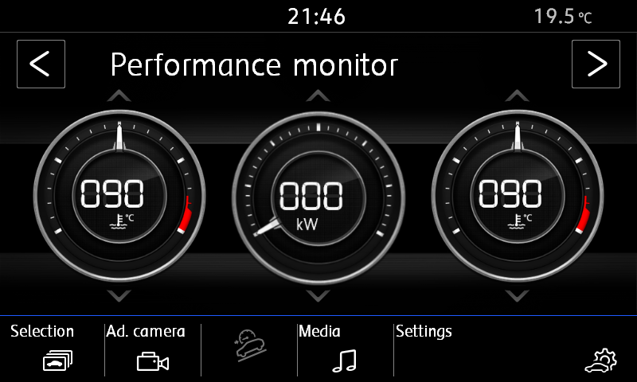
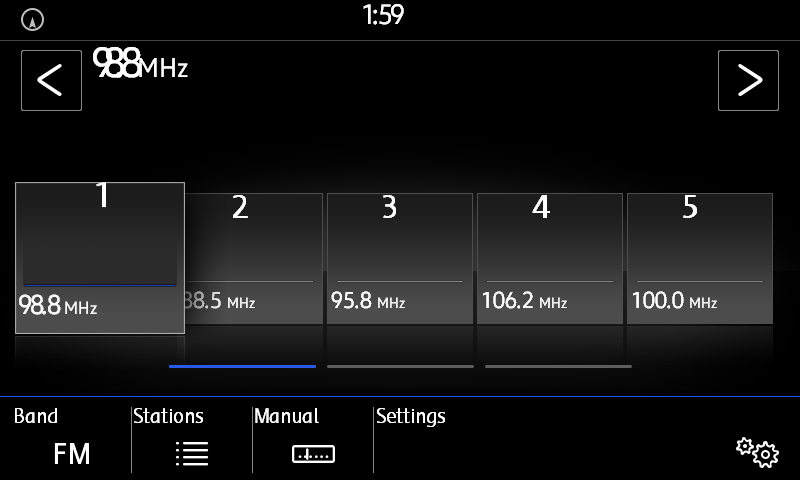
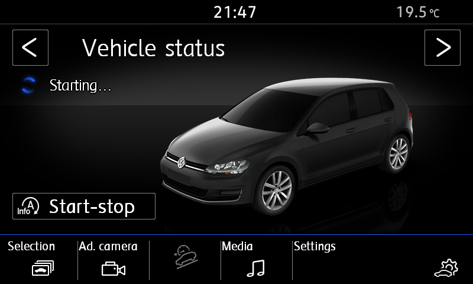
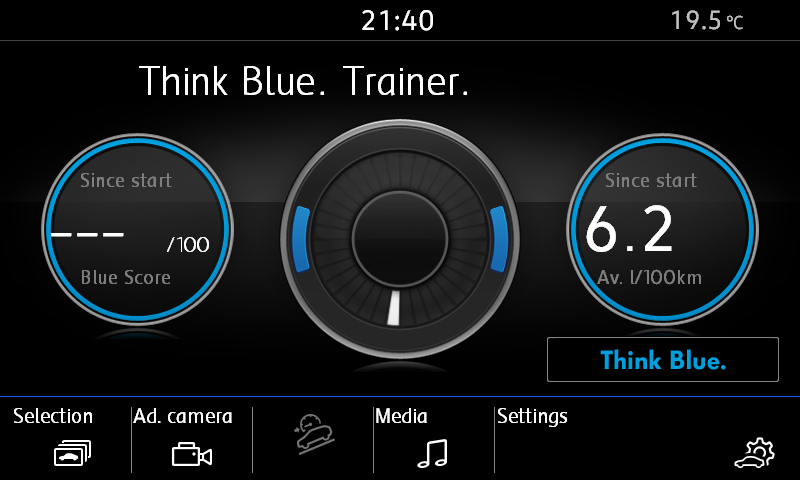

# VW MIB2 Emulator

Run the original Java infotainment interface from a Volkswagen Golf Mk7 MIB2 Standard on a Windows PC. The project loads firmware **P0369** on JDK 21 and provides host adapters for graphics, input and simulated vehicle data.

[Windows setup](docs/SETUP.md) · [QNX boot research](docs/P0369_BOOT_REPORT.md)

## Screenshots

| Performance monitor | FM radio |
| --- | --- |
|  |  |
| **Vehicle status** | **Think Blue. Trainer.** |
|  |  |

## What works

- **Desktop HMI** — an 800 × 480 window with touchscreen-style mouse input, keyboard controls and OpenGL ES 2.0 rendering via ANGLE / Direct3D 11.
- **Infotainment and vehicle screens** — FM radio, media and CAR views, including drive data, efficiency and performance gauges. Vehicle signals come from the simulator.
- **Local web dashboard** — view the framebuffer and send virtual key, touch and telemetry inputs after the runtime starts.

The desktop HMI and full-system emulation are separate milestones. QEMU executes the original QNX startup entry on an i.MX6 model. A complete QNX boot is still in progress.

## Run locally

Use **Windows x64**, **Node.js 22.2+**, and **JDK 21**. Follow the [Windows setup guide](docs/SETUP.md) for the native DLLs. Drop the stock P0369 archive or its smaller HMI tarball onto `run-vw-mib2.bat` to import the required files and start the emulator. After the first import, double-click the batch file to launch it again.

Use **R** for Radio, **E** for Media, **C** for CAR and **M** for Menu. The local dashboard listens on port **8080**. Run `npm test` for the parser and JVM converter tests. Tests that require firmware fixtures skip when those files are absent.

## Project layout

| Path | Contents |
| --- | --- |
| [`src/track-a/`](src/track-a/) | JVM launcher, J9 bytecode conversion, native adapters and vehicle simulation |
| [`tools/`](tools/) and [`scripts/`](scripts/) | Firmware image analysis and QEMU experiments |
| [`tests/`](tests/) | Automated parser and conversion checks |
| [`docs/`](docs/) | Setup, screen captures and technical notes |

Independent research project. Volkswagen firmware, extracted runtime resources and prebuilt distributions are supplied separately by the person running the emulator.
