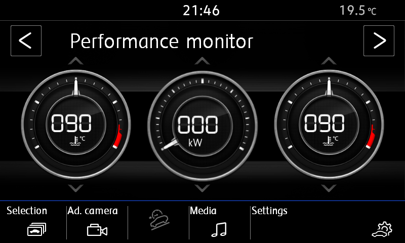
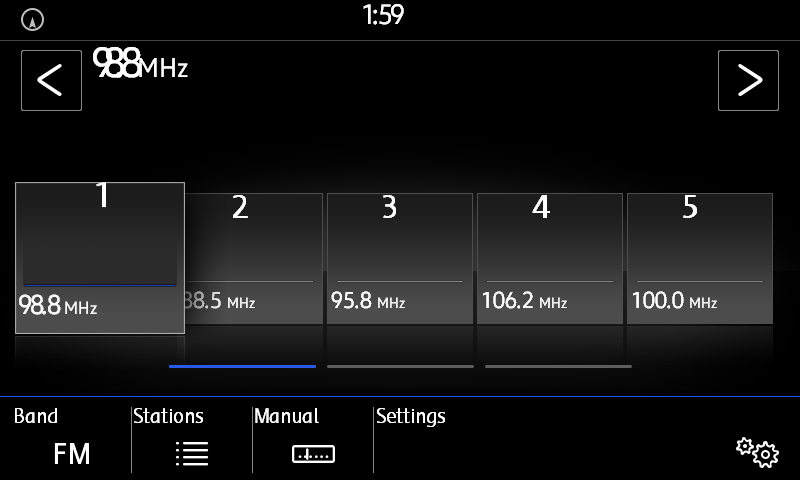
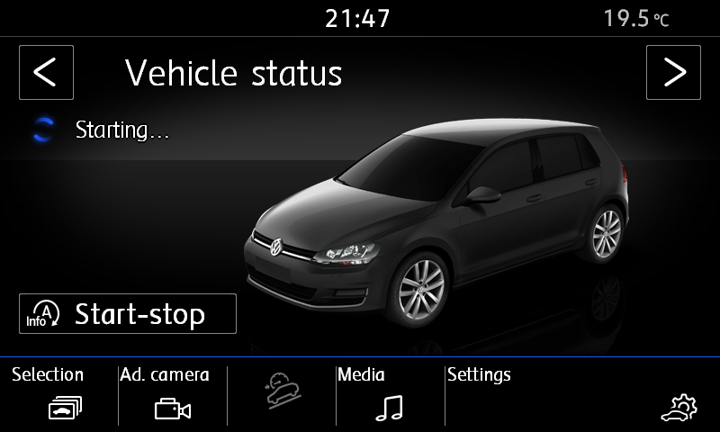
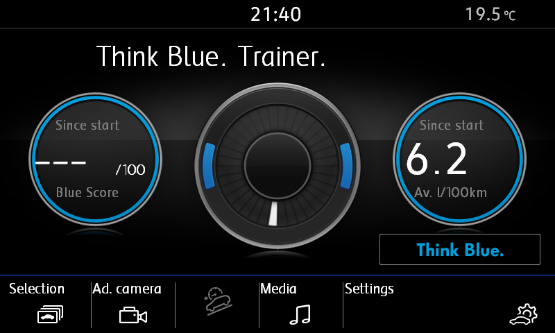

# Screen captures

These 800 × 480 frames were captured from the P0369 emulator. Vehicle values and radio data shown here come from the local runtime.

| Performance monitor | FM radio |
| --- | --- |
|  |  |
| **Vehicle status** | **Think Blue. Trainer.** |
|  |  |

Open `docs/index.html` from a local clone to switch between these frames in a browser. The [Windows setup guide](SETUP.md) explains how to launch the interactive HMI.
